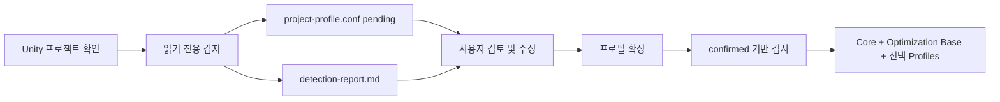

# 범용 Unity 하네스 아키텍처

> 이 문서는 게임 프로젝트의 아키텍처를 미리 정하지 않습니다. 하네스가 프로젝트를 감지하고, 사용자가 프로필을 확정하며, 규칙을 안전하게 활성화하는 구조를 설명합니다.

## 1. 하네스 모듈 구조

```text
.agents/
├── config/                 프로필 스키마, 감지 서명, 확정 프로필
├── scripts/
│   ├── shared/             안전한 프로필 파서, 감지기, 린터
│   ├── init/               초기 감지·재감지·확정 진입점
│   ├── lint/               프로필 기반 검사 진입점
│   ├── setup/              전역 에이전트 도구의 읽기 전용 상태 확인과 명시적 설치
│   └── ci/                 읽기 전용 전체 검사 진입점
├── tests/                  Bash 계약 테스트와 PowerShell 동등성 테스트
├── docs/
│   ├── coding-standards/   Core와 Optimization Base
│   ├── profiles/           조건부 아키텍처·도구 규칙
│   └── onboarding/         에이전트·개발자 사용 흐름
└── reports/                감지 근거와 비교 보고서
```

- `config/profile-schema.conf`는 허용 키·중복 여부·열거값의 단일 계약입니다.
- `scripts/shared/`는 사용자 설정을 실행하지 않고 파싱하며 프로젝트를 읽기 전용으로 조사합니다.
- Bash와 PowerShell 진입점은 같은 프로필 값, 종료 코드, 규칙 ID를 사용합니다.
- 게임 코드의 구조는 `architecture` 값에 대응하는 [아키텍처 Profiles](docs/profiles/architecture/)가 설명합니다.

## 2. 감지·검토·확정 흐름



1. 초기화 진입점은 Unity 프로젝트 표식을 확인합니다.
2. 감지기는 패키지와 실제 코드 사용 증거를 분리해 후보값을 만듭니다.
3. 첫 결과는 `confirmation_status=pending`인 `.agents/config/project-profile.conf`와 `.agents/reports/detection-report.md`입니다.
4. 사용자가 감지 근거와 경로를 검토하고 필요한 값을 수정합니다.
5. `--confirm` 또는 `-Confirm`이 스키마를 다시 검증한 뒤 상태를 `confirmed`로 원자적으로 변경합니다.
6. 재감지는 확정 프로필을 덮어쓰지 않고 `.agents/config/project-profile.candidate.conf`와 비교 보고서를 만듭니다.

## 3. 규칙 활성화 방향

```text
project-profile.conf
        │
        ├── Core ───────────────────── 항상 강제
        ├── Optimization Base ──────── 적용 의무 확인, 관련 작업 전 상세 로드·상태·측정으로 적용
        └── Profiles ───────────────── confirmed 선택만 강제
```

| 조건 | 활성 규칙 | 비활성 또는 축소 규칙 |
|------|-----------|------------------------|
| 프로필 없음 | 없음 | 구현을 시작하지 않음 |
| `pending` | Core, Optimization Base | 선택 Profiles는 경고 또는 참고 |
| `confirmed` | Core, Optimization Base, 선택 Profiles | 선택되지 않은 Profiles |
| `architecture=custom` | Core, Optimization Base, 사용자가 기록한 경계 | 일반 아키텍처의 전용 규칙 |

Optimization Base는 특정 렌더링 기능을 무조건 켜는 목록이 아닙니다. 프로필 상태, 타겟 플랫폼, 프로파일링 수치, 부작용과 롤백 조건을 함께 기록하는 의사결정 기준입니다.

상세 문서 읽기 시점은 [AGENTS 읽기 라우팅](AGENTS.md)의 작업 분류·실제 영향으로 정하며 Core·Optimization Base·확정 프로필 및 업무 고정 정책의 적용 의무와 별개입니다. 미로딩은 정책 면제가 아닙니다.

## 4. 생성 파일 경계

하네스 초기화와 재감지가 생성·갱신할 수 있는 파일은 다음 경계로 제한됩니다.

| 파일 | 생성 시점 | 보호 정책 |
|------|-----------|-----------|
| `.agents/config/project-profile.conf` | 첫 감지 | 확정 후 일반 감지로 덮어쓰지 않음 |
| `.agents/reports/detection-report.md` | 감지·재감지 | 근거와 비교 결과만 기록 |
| `.agents/config/project-profile.candidate.conf` | 재감지 | 확정 프로필과 별도 보관 |

- 감지와 검사는 `${source_root}`, `${test_root}` 및 프로젝트 설정을 읽을 뿐 게임 소스를 수정하지 않습니다.
- 프로필 작성은 임시 파일 검증 후 교체하고, 실패 시 기존 파일을 보존합니다.
- 출력 경로의 링크·재분석 지점은 거부하여 프로젝트 바깥 파일을 덮어쓰지 않습니다.
- 실제 기능 구현은 별도의 승인된 실행 계획에 따라 수행합니다.

## 5. 프로젝트 아키텍처 연결

확정된 `architecture` 값에 맞는 문서만 프로젝트 의존 방향의 권위로 사용합니다.

- [MVVM](docs/profiles/architecture/mvvm.md)
- [MVP](docs/profiles/architecture/mvp.md)
- [MVC](docs/profiles/architecture/mvc.md)
- [Layered/Clean](docs/profiles/architecture/layered-clean.md)
- [Custom](docs/profiles/architecture/custom.md)

DI, 비동기, 트윈, 렌더링도 각각의 Profile 문서를 통해 독립적으로 선택합니다. 예를 들어 `dependency_injection=none`은 오류가 아니라 Composition Root에서 명시적으로 객체를 조립하는 지원 분기입니다.

## 6. 에이전트 도구 경계

`config/agent-tooling.conf`는 Karpathy Guidelines, Superpowers, Understand-Anything의 ID와 설치 소스를 관리합니다. `scripts/setup/check-agent-tooling.sh`와 PowerShell 동등 진입점은 전역 설정과 실제 스킬 진입점을 함께 확인하지만 Unity 소스 린트에는 결합하지 않습니다.

- `--check`·`-Check`: 읽기 전용이며 `installed`, `disabled`, `broken`, `missing`을 고정 순서로 보고합니다.
- `--install-missing`·`-InstallMissing`: 사용자가 명시한 경우에만 누락 도구를 설치합니다.
- Superpowers는 `${CODEX_HOME:-$HOME/.codex}/superpowers`와 사용자 홈의 전역 `superpowers` 스킬 링크 구조를 함께 권위로 삼습니다.
- 초기화·린트·CI는 전역 설정이나 네트워크를 변경하지 않습니다.
- 자세한 적용 시점과 복구 흐름은 [에이전트 도구 준비](docs/onboarding/agent-tooling.md)를 따릅니다.
