# AI 에이전트 온보딩

작업 전 자기 실행 루트의 [AGENTS.md](../../AGENTS.md)를 직접 읽고 최신 사용자 요구·승인 범위·역할·보호 경계·확정 프로필을 확인합니다. [ARCHITECTURE.md](../../ARCHITECTURE.md)와 상세 문서는 AGENTS의 작업 분류·실제 영향에 따라 관련 분석·설계 전에 읽습니다. 적용 의무와 읽기 시점은 별개이며 미로딩은 정책 면제가 아닙니다.

## 프로필 준비 흐름

### 1. 초기화

프로필이 없거나 최초 투입이면 운영체제에 맞는 한 명령을 실행합니다.

```bash
bash .agents/scripts/init/initialize-harness.sh --project-root .
```

```powershell
powershell -NoProfile -ExecutionPolicy Bypass -File .agents/scripts/init/initialize-harness.ps1 -ProjectRoot .
```

### 2. 감지 보고서 검토

`.agents/reports/detection-report.md`의 값·신뢰도·근거 파일을 실제 프로젝트와 대조하고 `.agents/config/project-profile.conf`를 수정합니다. `pending`은 추정값 검토 중이라는 뜻입니다.

### 3. 프로필 확정

검토가 끝났을 때만 확정합니다.

```bash
bash .agents/scripts/init/initialize-harness.sh --project-root . --confirm
```

```powershell
powershell -NoProfile -ExecutionPolicy Bypass -File .agents/scripts/init/initialize-harness.ps1 -ProjectRoot . -Confirm
```

### 4. 검사 명령 준비

다음 명령은 사용자가 현재 하네스 검사를 요청한 경우에만 실행하는 예시입니다. 요청하지 않았다면 `not_run`으로 기록합니다.

```bash
bash .agents/scripts/lint/check-harness.sh --project-root .
```

```powershell
powershell -NoProfile -ExecutionPolicy Bypass -File .agents/scripts/lint/check-harness.ps1 -ProjectRoot .
```

## Unity worktree·Editor 준비 게이트

Unity 작업 전 현재 실행 루트의 물리 절대 경로와 Git 유형을 `normal_checkout`, `linked_worktree`, `submodule`, `non_git` 중 하나로 판별합니다. 모든 실행 루트는 실행 중 Editor를 사용할 때 `unity status --format json`의 인스턴스 `project`와 대상 물리 프로젝트 루트의 exact match, `unity command editor_status --project-path <물리 경로>`의 `projectPath` exact match·`status=ready`(승인된 PlayMode 관측·정지·캡처는 `playing` 허용)·`compiling=false`를 확인합니다. `linked_worktree`이면 추가로 `ProjectSettings/ProjectVersion.txt` 버전과 물리 `projectPath`의 전용 Editor를 준비합니다.

port는 identity가 아니며 CLI가 관리합니다. 모든 `unity command` 호출은 `--project-path <물리 절대 경로>`를 명시합니다. 바인딩이 `ready`가 아니면 `background: editor_unavailable`로 기록하고 CLI·batchmode 백그라운드 경로로 파견하며, 실행 루트를 확정할 수 없을 때만 구현 서브 에이전트를 파견하지 않고 Unity 구현 전체를 중단합니다. 상세 순서와 복구·증거 경계는 [Unity linked worktree Editor·CLI 격리](unity-worktree-cli.md)를 따릅니다. Editor 비의존 변경(기존 `.cs` 로직 수정만·직렬화 표면 불변·scene/prefab/asset/UI 배치/Inspector 값 무변경)은 이 게이트의 대상이 아니며 실행 루트 판별만 하고 파견합니다 — 정의는 [Unity linked worktree Editor·CLI 격리](unity-worktree-cli.md)의 적용 범위를 따릅니다.

## 규칙 로딩

- Core와 Optimization Base의 적용 의무는 항상 확인하고, 관련 상세 문서는 [AGENTS 읽기 라우팅](../../AGENTS.md)의 작업 분류·실제 영향에 따라 작업 전에 읽습니다. 미로딩은 정책 면제가 아닙니다.
- `confirmed`일 때만 선택된 architecture, DI, async, tween, rendering Profiles를 강제합니다.
- `pending`은 선택 Profiles를 참고 또는 경고로만 사용합니다.
- `architecture=custom`이면 [Custom 경계 문서](../profiles/architecture/custom.md)와 프로젝트의 `.asmdef`·문서를 근거로 판단합니다.
- 생성·수정은 `${source_root}`, 테스트는 `${test_root}` 범위로 한정합니다.

## 코드 검사 경계 확인

코드 검사는 `project-profile.conf`의 `source_root`를 사용하며 모든 `source_root`는 `Assets/_Game` 또는 그 하위 경로여야 합니다. `Assets/_Game` 밖의 Asset Store, UPM과 기타 외부 에셋 코드는 검사하지 않습니다. `_Game` 내부의 외부 원본만 `exclude_root`로 명시합니다.

## Unity 기능·마일스톤 검증

다음은 사용자가 해당 검증을 현재 요청한 경우에 실행하는 품질 명세입니다. 요청하지 않은 항목은 `not_run`이며 통과로 간주하지 않습니다.

- 개별 Task 검증 범위는 정적 검사, 대상 테스트, 논리적 변경 묶음 단위 Unity 컴파일이며 Player Build를 포함하지 않습니다.
- 기능·마일스톤 검증은 `Assets/_Game` 프로젝트 소유 모듈과 상호작용의 전체 자동화 통합 테스트를 수행합니다.
- Player Build가 현재 명시적으로 요청된 경우 사전 게이트를 통과한 동일 변경분에만 1회 수행하며, Unity CI Build Validation이 있으면 로컬 중복 빌드를 수행하지 않습니다.
- 증거 형식과 변경 후 무효화 기준은 [Unity 기능·마일스톤 검증 정책](../coding-standards/core/unity-validation.md)을 따릅니다.

## 에이전트 작업 프로세스

```mermaid
flowchart LR
    A[실행 루트와 worktree 판별] --> B[프로필 확인]
    B --> C[실제 파일 분석]
    C --> D[설계·실행 계획]
    D --> E[사용자 전체 승인]
    E --> F[Editor 바인딩과 필요 시 전용 Editor]
    F --> G[메인 에이전트 규칙 전달]
    G --> H[서브 에이전트 구현]
    H --> I[컴파일·구문 오류 확인]
    I --> J[서브 에이전트 완료 보고]
    J --> K[메인 에이전트 독립 리뷰]
    K --> L[사용자가 요청한 검증]
    L --> M[not_run 포함 최종 보고]
```



부분 질문에 대한 답이나 문서 코멘트는 전체 구현 승인이 아닙니다. 계획을 갱신한 뒤 사용자에게 구현 시작 여부를 다시 확인합니다. 모든 구현 파일 생성·수정은 필수 전달 패킷을 받은 구현 서브 에이전트가 수행하며 메인 에이전트는 구현하지 않습니다. Unity 작업은 모든 실행 루트의 Editor identity 바인딩과 `linked_worktree`의 전용 Editor 상태가 `ready` 또는 `background: editor_unavailable`인 경우에 전달하며(`blocked`는 실행 루트 미확정일 때만), 적용 가능한 코드·스크립트는 컴파일·구문 오류 확인까지 필수이고 문서만 변경하면 `N/A`입니다. 중요한 리뷰 지적은 같은 구현 서브 에이전트가 수정하고 메인 에이전트가 재리뷰합니다.

## 완료 안내

- Inspector에서 연결할 `func_` 버튼 메서드
- 새 직렬화 필드와 할당 대상
- 이벤트 구독·해제 위치
- 컴파일·구문 확인 결과 또는 문서 변경의 `N/A`
- 사용자 요청으로 실행한 검사, `not_run` 항목과 남은 위험

Editor 기동은 `bash .agents/scripts/setup/open-unity-editor.sh --project-root <물리 절대 경로>`를 사용합니다. 이미 `unity open` 실패를 확인했다면 `--skip-cli`를 지정합니다. 동일 버전 앱을 직접 실행해도 [Unity CLI 실행 가이드](unity-cli.md)의 후속 identity·ready 확인을 통과해야 합니다.

작업 종료·반복 방지는 [AGENTS](../../AGENTS.md)의 작업 종료와 반복 방지 절을, 매 파견 모델 배정과 현재 승인 예외는 [도구 준비](agent-tooling.md)의 역할별 에이전트·모델 분담 절을 따릅니다.
